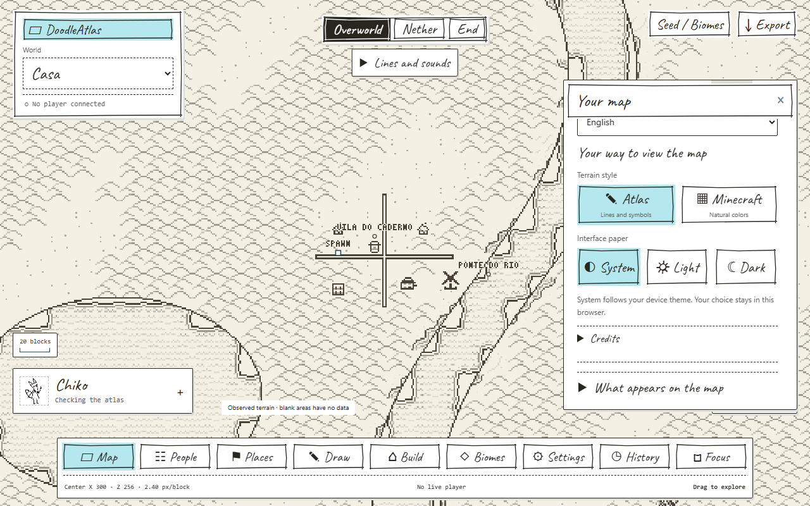

<p align="center"></p>

**English** · [Português](README.md)

# DoodleAtlas

**Your world, kept between maps and doodles.**

DoodleAtlas is an interactive cartography tool for **Minecraft Bedrock**. Its interface feels like a handmade notebook: paper, black-and-white lines, animated sketch borders and little cyan accents. View the terrain as an illustrated atlas or with natural Minecraft colors and relief.

**Chiko is the atlas librarian.** He keeps your maps and travel records as you explore. The character belongs to [Hachiko / Noah](https://www.tiktok.com/@hachikookami).

[Gallery](docs/GALERIA.md) · [User guide, Portuguese](docs/GUIA.md) · [Project structure, Portuguese](docs/ESTRUTURA.md) · [Contributing, Portuguese](docs/CONTRIBUINDO.md)

## Features

- **Doodle notebook:** light, dark and system themes, sketch borders and optional sounds.
- **Two terrain styles:** illustrated Atlas or natural Minecraft colors with relief.
- **Manual editor:** brushes, connecting roads and fences, stamps, background painting and modular buildings.
- **Three dimensions:** Overworld, Nether and End.
- **Live players:** positions and entities when the pack sends game data.
- **Places and characters:** personal or shared waypoints, presets and manual skin/face PNG uploads.
- **Per-world records:** drawings, chunk history and frames of a selected main region.
- **PNG export:** the visible area with optional title, north arrow, scale and annotations.
- **Optional seed preview:** experimental predictions behind observed terrain.
- **Português / English:** switch under Your map. Your choice stays in this browser.

## Inside the notebook

These screenshots show the running interface with **fictional demonstration data**. They are not a real save or a performance measurement. The icon is an AI-generated adaptation of the supplied Chiko reference.

| Paper atlas | Cartography editor |
| --- | --- |
|  |  |
| Shared places | Natural colors |
|  |  |

[More screenshots: history, night theme and English interface](docs/GALERIA.md).



## Project structure

```text
DoodleAtlas/
├── src/chiko/          Application; technical name kept for compatibility
│   ├── network/        Connection and protocol
│   ├── world/          Save discovery and reading
│   ├── storage/        Data, drawings and history
│   ├── cartography/    Palette, relief and tiles
│   ├── web/            Interface, map, editor and translations
│   ├── assets/         Icon, mascot, font and atlas art
│   ├── bedrock_pack/   Addon for live data
│   └── vendor/         Optional seed generator and licenses
├── config/             Public example; local settings are ignored by Git
├── docs/               Guides and screenshots
├── scripts/            Installation and development tools
├── tests/              Tests and simulations
├── instalar.bat        Set up portable Python on Windows
├── iniciar.bat         Start the server
├── parar.bat           Stop the application
├── pyproject.toml      Package and commands
├── requirements.txt    Python dependencies
├── THIRD_PARTY_NOTICES.md
├── LICENSE
├── README.en.md
└── README.md
```

Assets ship inside the package. Worlds, captures, tokens, logs and personal settings stay out of Git.

## Install and run

The prepared environment targets **Windows x64 with Python 3.12**. The pack declares a minimum engine version of **1.26.50** and Script API **2.9.0**; future versions are not guaranteed. The optional native seed generator targets Windows x64.

```powershell
git clone https://github.com/murasakll/Bedrock-Real-Time-Map-Viwer.git DoodleAtlas
cd DoodleAtlas
```

### Simple Windows setup

Run `instalar.bat`, then `iniciar.bat`. The installer downloads Python and dependencies into `runtime/` and creates `dist/Chiko-Universal.mcpack`. Open the address shown in the terminal.

For live data, import the `.mcpack`, enable it in your world and link it under **Settings → Game reading and capture**. Save and leave the world before installing or updating the pack. Run `parar.bat` to stop the app.

### With your own Python

```powershell
python -m venv .venv
.\.venv\Scripts\Activate.ps1
python -m pip install -r requirements.txt
python -m pip install -e . --no-deps
python -m chiko init
python -m chiko worlds
python -m chiko pack
python -m chiko serve --world "worlds/MyWorld"
```

Replace `worlds/MyWorld` with your save path. The `chiko` module and pack filename remain for compatibility; the project is called **DoodleAtlas**.

### World, address and ports

`python -m chiko init` creates **config/settings.local.json** from the example without overwriting your settings. Adjust the fields you need:

```json
{
  "world": "worlds/MyWorld",
  "http_host": "0.0.0.0",
  "http_port": 8080,
  "advertise_host": "auto"
}
```

This is an excerpt: keep the other fields in the generated file. `0.0.0.0` listens on the PC's interfaces; `auto` detects the advertised address. On the host PC, use the local address shown in the terminal. On a phone, use the PC's LAN address and the same port. **127.0.0.1 works for local access**; on another device, it points to that device.

Minecraft has separate fields: `minecraft_host`, `minecraft_port` and `minecraft_advertise_host`. Their local defaults serve the game on the same PC. A remote IP alone does not provide another server's save or log.

## Language and writing

Open **Your map → Language** to choose **Português** or **English**. The first visit follows the browser language when supported; later visits use your saved choice. User-written names and commands are kept as entered.

The copy is still being written. Short, personal wording is welcome. See [Editing the text](docs/TEXTOS.md) for where the Portuguese source copy and English translations live. Technical diagnostics from dependencies may remain in their original language.

## Limits and local data

The reader works on disposable save snapshots. The pack reads only terrain accessible in the game. Seed predictions do not confirm buildings. History records observed changes; it cannot reconstruct the past. The main region supports up to **4,096 chunks** and has storage limits.

Local settings, `data/`, `mapas/`, `logs/` and worlds are excluded from the repository. Open SQLite databases need a consistent backup; see the [backup guide, Portuguese](docs/GUIA.md#dados-e-backup). There is no promised FPS improvement or automatic support for every Realm or public server.

## Development

```powershell
python -m unittest discover -s tests -v
node tests/web_smoke.mjs
```

Tests use temporary data and simulations. They do not replace real game, mobile or long-session testing.

## Credits

- **Project and code:** [murasakll](https://github.com/murasakll).
- **Chiko character:** [Hachiko / Noah](https://www.tiktok.com/@hachikookami). Chiko acts as the map librarian in DoodleAtlas. The pixel art and presentation illustrations are AI-generated adaptations of the supplied references.
- **Atlas art:** [Antique Atlas / Hunternif and contributors](https://github.com/AntiqueAtlasTeam/AntiqueAtlas), **CC BY-NC-SA 3.0**.
- **Handwritten font:** Caveat, bundled locally under **SIL OFL 1.1**.
- **Optional seed generator:** Cubiomes / Cubitect and SeedForge, with their own MIT licenses.
- **Libraries:** Amulet Core, aiohttp, Pillow, qrcode and cryptography.

[Third-party notices, attribution and changes](THIRD_PARTY_NOTICES.md).

## License

Original **DoodleAtlas** code is available under the [MIT license](LICENSE). You may use, modify and distribute that code while retaining the copyright notice and license.

MIT does **not replace third-party licenses or character rights**. Antique Atlas art remains under **CC BY-NC-SA 3.0**, including its noncommercial condition. Chiko belongs to Hachiko / Noah; no open license for the character is granted here.

Independent project, not affiliated with or endorsed by Mojang, Microsoft or Antique Atlas.
