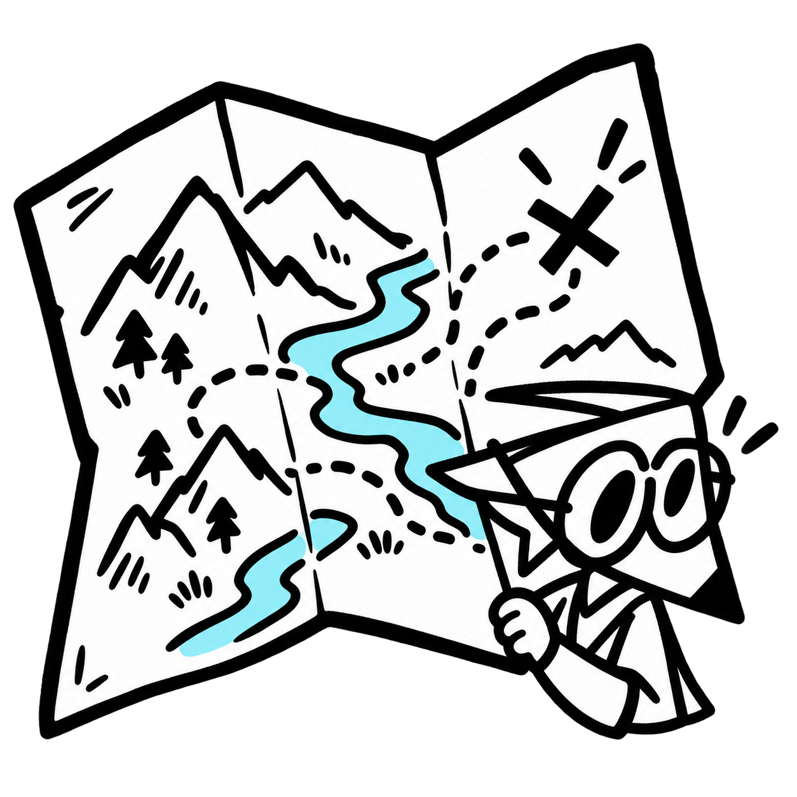
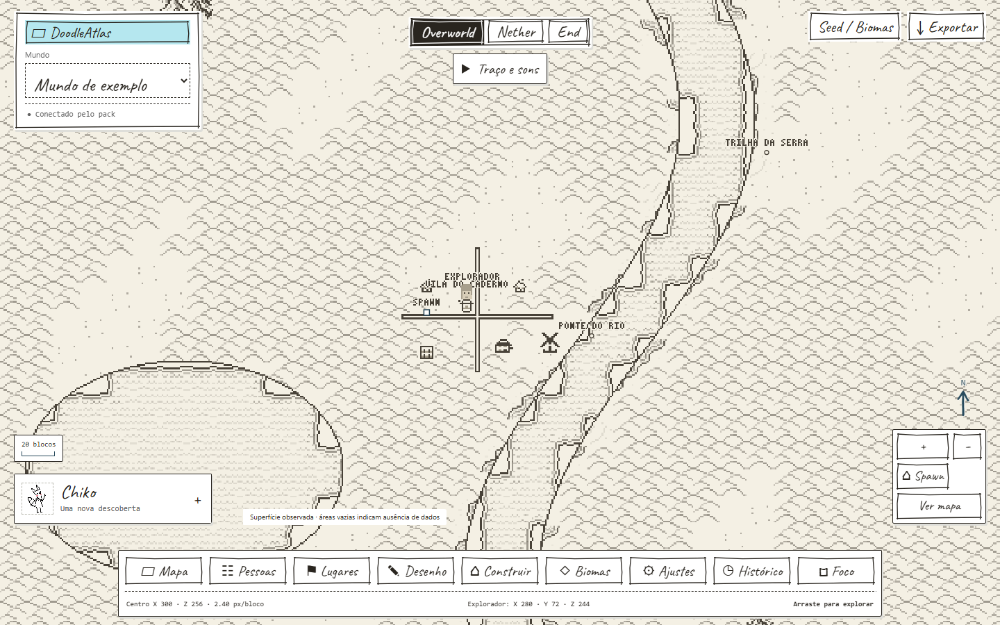
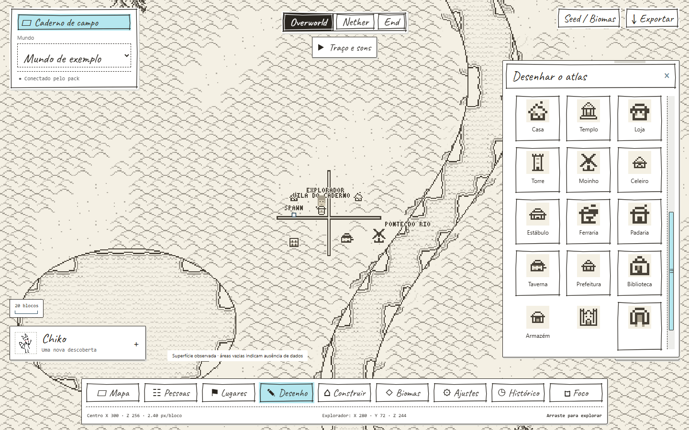
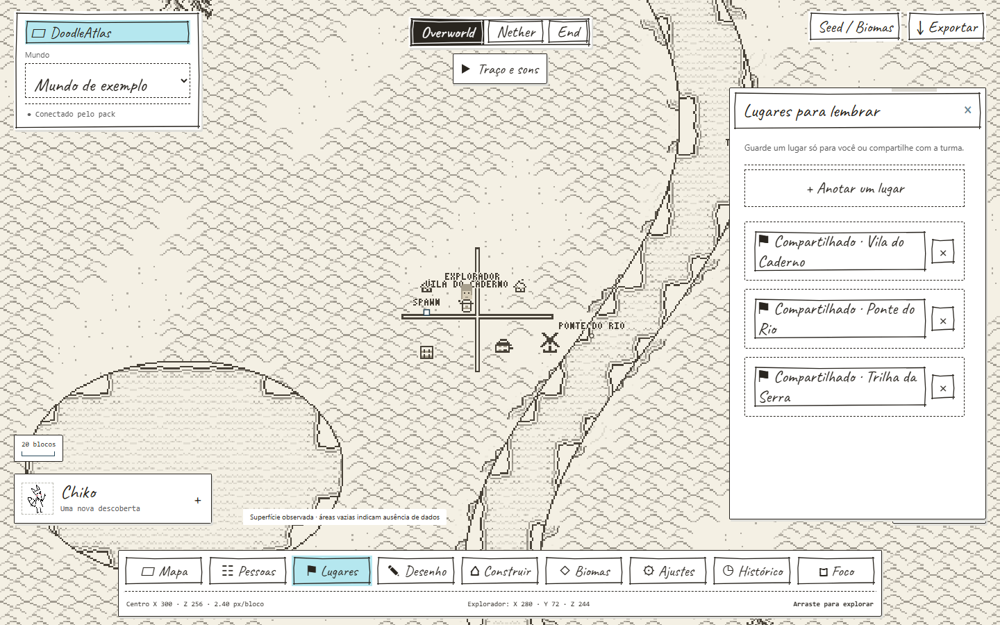
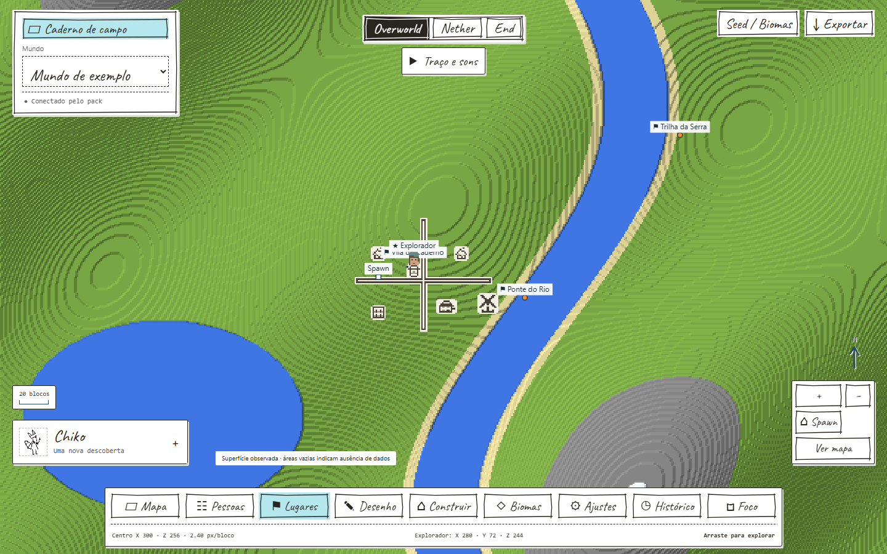

<p align="center"></p>

<h1 align="center">DoodleAtlas</h1>
<p align="center"><b>Your world, kept between maps and doodles.</b></p>
<p align="center"><a href="README.md">Português</a> · <b>English</b></p>
<p align="center"><a href="https://github.com/murasakll/Bedrock-Real-Time-Map-Viwer/releases/tag/v0.2.0"><b>Download DoodleAtlas</b></a> · <a href="https://github.com/murasakll/Bedrock-Real-Time-Map-Viwer/releases">All releases</a></p>
<p align="center"><a href="docs/GUIA.md">Guide</a> · <a href="docs/GALERIA.md">Gallery</a> · <a href="docs/ESTRUTURA.md">Structure</a> · <a href="docs/CONTRIBUINDO.md">Contribute</a></p>

An interactive map for **Minecraft Bedrock** that looks like a handmade notebook. View your world and players in the browser, draw your village on top and export it as an image.

**Chiko is the atlas librarian:** he follows your exploration and keeps the maps and records. The character belongs to [Hachiko / Noah](https://www.tiktok.com/@hachikookami).

| Paper atlas | Cartography editor |
| --- | --- |
|  |  |
| **Shared places** | **Natural colors** |
|  |  |

<sub>Screenshots use fictional demonstration data, not a real save. The icon is an AI-generated adaptation of the Chiko reference. [See more in the gallery](docs/GALERIA.md).</sub>

## What you can do

- **View your world in the browser:** runs on your PC and opens on a phone on the same network. Terrain comes from the save itself, even with nobody online, through a temporary copy that leaves the original database untouched.
- **Follow players live:** a behavior pack sends positions and terrain samples through the Content Log.
- **Choose the look:** Atlas terrain (Antique Atlas art) or Minecraft terrain (natural colors and relief), across all three dimensions: Overworld, Nether and End.
- **Draw on the map:** brushes, roads and fences that connect automatically, house, temple and windmill stamps, background painting and modular buildings. Drawings are annotations and do not change the game.
- **Mark places and characters:** personal or shared waypoints, automatically detected beds and portals, appearance presets and skin or face PNG uploads.
- **Watch a region change:** chunk versions and frames of a main region of up to 4,096 chunks.
- **Export:** a PNG of the framed area, with optional title, north arrow, scale and annotations, or JSON of your edits.
- **Predict biomes (experimental):** the seed preview always sits behind terrain that has actually been observed.
- **Make it yours:** light, dark or automatic theme, animated sketch borders, optional sounds and a Portuguese/English interface.

## Get started

**You need:** Windows x64 and Minecraft Bedrock. The installer downloads Python 3.12 and the dependencies for you.

```powershell
git clone https://github.com/murasakll/Bedrock-Real-Time-Map-Viwer.git DoodleAtlas
cd DoodleAtlas
```

1. Run **`instalar.bat`**. It sets up Python in `runtime/` and creates `dist/Chiko-Universal.mcpack`.
2. Run **`iniciar.bat`** and open the address shown in the terminal.
3. Choose your world in the site's selector.

To stop, use `parar.bat`. To open it on a phone, use the PC's local network address with the same port.

### Enable live players

1. Save and leave the world.
2. Import `dist/Chiko-Universal.mcpack` into Minecraft and enable it in your world, disabling older versions.
3. Enable Content Log recording in the creator settings.
4. Open the world, then go to **Settings → Game reading and capture** on the site to copy the linking command.
5. In chat, as host or operator, run `/livemap:vincular ...` with the identifier shown.

Adjust the capture rate with `/livemap:taxa`. The guide explains each value.

<details>
<summary><b>Install with your own Python</b></summary>

```powershell
python -m venv .venv
.\.venv\Scripts\Activate.ps1
python -m pip install -r requirements.txt
python -m pip install -e . --no-deps
python -m chiko init
python -m chiko worlds
python -m chiko pack
python -m chiko serve --world "worlds/MyWorld"
```

Replace `worlds/MyWorld` with your save path. The `chiko` module and pack filename are older names kept for compatibility.
</details>

<details>
<summary><b>Configure the world, address and ports</b></summary>

`python -m chiko init` creates `config/settings.local.json` without overwriting what you already have:

```json
{
  "world": "worlds/MyWorld",
  "http_host": "0.0.0.0",
  "http_port": 8080,
  "advertise_host": "auto"
}
```

`0.0.0.0` makes the server listen on the network, but is not the address you type into the browser. On the PC itself, use `127.0.0.1`. On a phone, use the PC's local network address and the same port. Minecraft uses separate connection fields (`minecraft_host`, `minecraft_port` and `minecraft_advertise_host`). More about networking, PIN and troubleshooting is in the [guide](docs/GUIA.md).
</details>

## What it does not do

- **It does not change the game:** drawings and buildings are atlas annotations.
- **It does not show locations from the seed:** the preview only predicts biomes.
- **It does not access Realms or public servers automatically:** having a remote server's IP does not give access to its save or log.
- **It does not promise compatibility with future Minecraft versions.** The pack declares a minimum engine version of **1.26.50** and Script API **2.9.0**.

Worlds, captures, `data/`, `mapas/`, `logs/` and personal settings stay out of Git. To back up open SQLite databases, see the [guide's procedure](docs/GUIA.md#dados-e-backup).

## Development

The test suite is kept locally and is not included in this repository. See [how to contribute](docs/CONTRIBUINDO.md) and the [project structure](docs/ESTRUTURA.md). To give the copy and translations your own voice, see [where to edit](docs/TEXTOS.md).

## Credits

- **Project and website:** [murasakll](https://github.com/murasakll) created the site and interface.
- **Map logic:** most of it was developed with [ChatGPT (OpenAI)](https://openai.com/) and [Claude (Anthropic)](https://www.anthropic.com/).
- **Chiko character:** [Hachiko / Noah](https://www.tiktok.com/@hachikookami). The character belongs to him; the pixel art image is temporary.
- **Atlas art:** [Antique Atlas / Hunternif and contributors](https://github.com/AntiqueAtlasTeam/AntiqueAtlas)
- **Handwritten font:** Caveat
- **Map prediction:** Cubiomes / Cubitect and SeedForge
- **Libraries:** Amulet Core, aiohttp, Pillow, qrcode and cryptography

## License

Original code is distributed under the [MIT license](LICENSE).

MIT does not cover third-party dependencies, fonts or art: Antique Atlas art remains under **CC BY-NC-SA 3.0**, including its noncommercial condition, and the Caveat font remains under **SIL OFL 1.1**. Chiko belongs to Hachiko / Noah; no open license for the character is granted in this repository. Details are in [`THIRD_PARTY_NOTICES.md`](THIRD_PARTY_NOTICES.md).

Independent project, not affiliated with or endorsed by Mojang, Microsoft or Antique Atlas.
