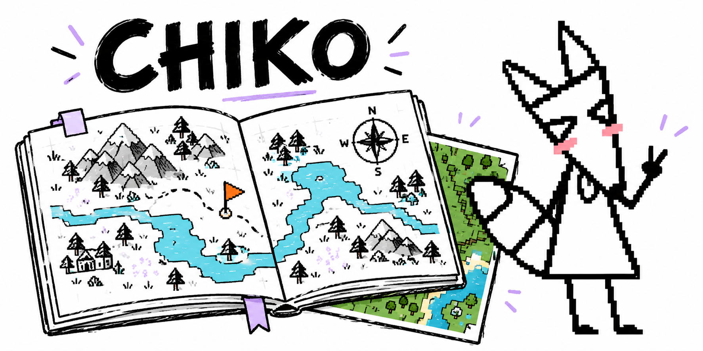

# Chiko · um caderno para seus mundos Bedrock

Terreno observado, amigos no mapa e um atlas que você pode desenhar. Uma página local com interface de caderno, bordas rabiscadas e o Chiko acompanhando a viagem.

**Windows · Minecraft Bedrock · navegador no PC e na LAN · em desenvolvimento**

[Começar](#começar-no-windows) · [Guia](docs/GUIA.md) · [Galeria](docs/GALERIA.md) · [Estrutura](docs/ESTRUTURA.md) · [Créditos](THIRD_PARTY_NOTICES.md)

## O que tem aqui

| Função | Como funciona |
| --- | --- |
| Dois estilos de terreno | Atlas com arte do Antique Atlas ou cores naturais com relevo. |
| Jogadores e entidades | Posições e dados acessíveis ao pack, quando o jogo envia a captura. |
| Cartografia manual | Estradas e cercas conectáveis, carimbos, pintura do fundo e construção modular. |
| Lugares para lembrar | Pontos pessoais no navegador ou compartilhados no mundo. |
| Personagens | Presets, acessórios e envio manual de skin/rosto PNG. |
| Histórico por região | Mudanças por chunk e quadros de uma região principal escolhida. |
| Exportação | PNG da área enquadrada, com título, norte, escala e anotações opcionais. |
| Caderno doodle | Temas claro/escuro/sistema, bordas sketch, modo foco e sons opcionais. |

O save fornece dados observados; o pack complementa o que está disponível no jogo. A prévia de seed é **opcional e experimental**, atrás do terreno real. Ela não confirma construções nem alterações de jogadores.

## Por dentro do caderno

Os prints abaixo mostram **a interface executada com dados fictícios**. Não são um save real nem uma prova de desempenho. A capa é uma ilustração gerada com IA a partir da identidade do Chiko.

| Atlas de papel | Editor cartográfico |
| --- | --- |
|  |  |
| Lugares compartilhados | Cores naturais |
|  |  |

[Mais imagens: histórico e tema noturno](docs/GALERIA.md).

## Começar no Windows

1. Baixe o repositório e extraia numa pasta sua.
2. Execute **instalar.bat**. Python 3.12 e dependências ficam em **runtime/**.
3. Execute **iniciar.bat**. Havendo vários mundos, escolha um em **config/settings.local.json** ou pela linha de comando abaixo.
4. Abra o endereço local mostrado no terminal. Outros aparelhos usam o endereço LAN do mesmo PC.
5. Para jogadores ao vivo, importe **dist/Chiko-Universal.mcpack**, ative no mundo e faça o vínculo em **Ajustes → Leitura e captura do jogo**.

O pack é gerado pelo instalador. Salve e saia do mundo antes de instalar ou atualizar um pack. Encerre o aplicativo com **parar.bat**.

~~~powershell
# Ver os mundos encontrados
.\runtime\python\python.exe -m chiko worlds

# Escolher um mundo
.\runtime\python\python.exe -m chiko serve --world "worlds/MeuMundo"

# Gerar novamente o addon universal
.\runtime\python\python.exe -m chiko pack
~~~

O pack atual declara engine mínima **1.26.50** e Script API **2.9.0**. Isso não garante versões futuras. [Instalação, vínculo, rede e solução de problemas](docs/GUIA.md).

### Já usa Python?

Use **Python 3.12** em um ambiente virtual:

~~~powershell
python -m venv .venv
.\.venv\Scripts\Activate.ps1
python -m pip install -e .
python -m chiko init
python -m chiko pack
python -m chiko serve --world "worlds/MeuMundo"
~~~

O caminho é seu; o projeto não vem com o save de ninguém. O suporte empacotado e o gerador nativo opcional são voltados a Windows x64.

## Limites atuais

- Um IP remoto não dá acesso ao save ou ao log de outro servidor. Não há integração automática com qualquer servidor público ou Realm.
- O pack não lê terreno arbitrário descarregado. A seed não confirma estruturas ou alturas exatas.
- O histórico não reconstrói um passado que não foi registrado. Sua região principal tem limite de **4.096 chunks**, quadros pequenos e cota de armazenamento.
- Não existe screenshot gigante periódico do mundo inteiro. Exportações grandes são solicitadas pelo usuário.
- Sons só começam após ativação manual. Sono e subterrâneo do Chiko ainda não são eventos reais integrados.
- Nenhum ganho de FPS é prometido sem medição equivalente. As animações podem ser pausadas.

## Seus dados ficam no seu PC

Configurações locais, **data/**, **mapas/**, **logs/**, mundos, capturas e tokens ficam fora do Git. Use o PIN para visitantes da LAN; ações administrativas continuam restritas ao host.

O parser lê snapshots descartáveis, não o LevelDB original. Uma cópia de mundo aberto ainda pode exigir novas tentativas. Bancos SQLite com WAL precisam de backup consistente: veja [dados e backup](docs/GUIA.md#dados-e-backup).

## Desenvolvimento

O código mora em **src/chiko/**, separado em rede, leitura do mundo, armazenamento, cartografia e interface. Veja a [árvore e o fluxo](docs/ESTRUTURA.md).

~~~powershell
python -m unittest discover -s tests -v
node tests/web_smoke.mjs
node tests/map_editor.mjs
node tests/map_buildings.mjs
node tests/pixel_avatars.mjs
node tests/tile_source.mjs
node tests/universal_pack.mjs
~~~

Os testes usam dados temporários e simulações. Não substituem Minecraft, celular ou uma sessão longa. [Como contribuir ou relatar um problema](docs/CONTRIBUINDO.md).

## Créditos e licenças

- **Arte do atlas:** [Antique Atlas / Hunternif](https://github.com/AntiqueAtlasTeam/AntiqueAtlas), **CC BY-NC-SA 3.0**. As adaptações da arte mantêm atribuição e termos não comerciais.
- **Personagem Chiko:** [Hachiko / Noah](https://www.tiktok.com/@hachikookami). A pixel art e a capa foram geradas com IA a partir da referência; não são apresentadas como desenhos feitos pelo criador.

Fontes, gerador de seed e dependências têm licenças próprias. O código autoral ainda não tem licença geral de reutilização definida; publicar no GitHub não relicencia material de terceiros. [Avisos completos](THIRD_PARTY_NOTICES.md).

Projeto independente, sem afiliação ou endosso da Mojang, Microsoft ou Antique Atlas.
