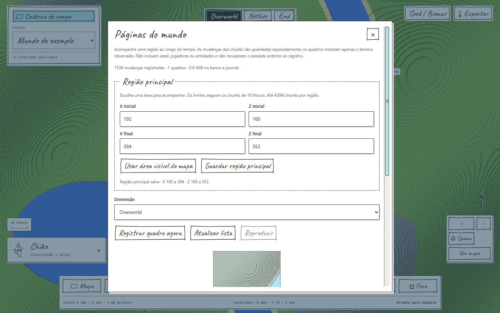
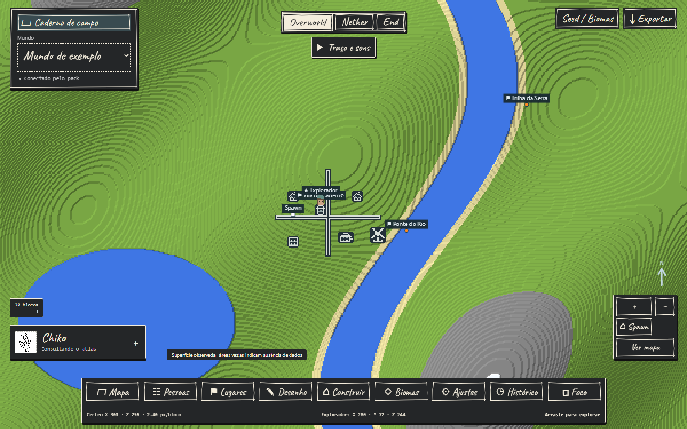

# Galeria do caderno

[Voltar ao projeto](../README.md)

Estas são capturas da interface real, executada em Chromium com terreno, jogadores e lugares **sintéticos**. Nenhum save ou jogador real foi usado. Elas mostram a apresentação das funções; não medem FPS nem comprovam a conexão de uma sessão Minecraft.

## Atlas

Terreno observado apresentado com os traços do Antique Atlas, camadas e navegação do caderno.


## Desenho

Paleta de carimbos e ferramentas de edição. A vila desenhada é uma anotação de demonstração; não é uma construção detectada no jogo.


## Lugares

Pontos compartilhados e acesso às anotações, separados por mundo.


## Cores naturais

O mesmo terreno sintético no estilo Minecraft, com relevo e água de superfície.


## Histórico por região

Escolha de limites e quadro da área principal. O exemplo contém um quadro; reprodução temporal precisa de pelo menos dois.



## Noturno

Papel escuro e controles com contraste, mantendo os estilos do mapa disponíveis.



## Reproduzir estas imagens

Ferramenta opcional de documentação, fora das dependências do aplicativo:

```powershell
python -m pip install playwright
python -m playwright install chromium
python scripts/capture_gallery.py
```

Ela inicia um servidor em porta aleatória, apenas no loopback, usa uma pasta temporária e sobrescreve os seis prints acima. Não abre Minecraft, não consulta seus mundos e não usa sua configuração local. O script usa o cache padrão do Playwright e também reconhece a instalação isolada em `runtime/gallery-tools` e `runtime/gallery-browsers`, quando existir.

A capa é uma ilustração gerada pelo recurso integrado de imagem, não um screenshot. O [brief da capa](images/chiko-banner.prompt.txt) e os [créditos](../THIRD_PARTY_NOTICES.md) acompanham o projeto.
